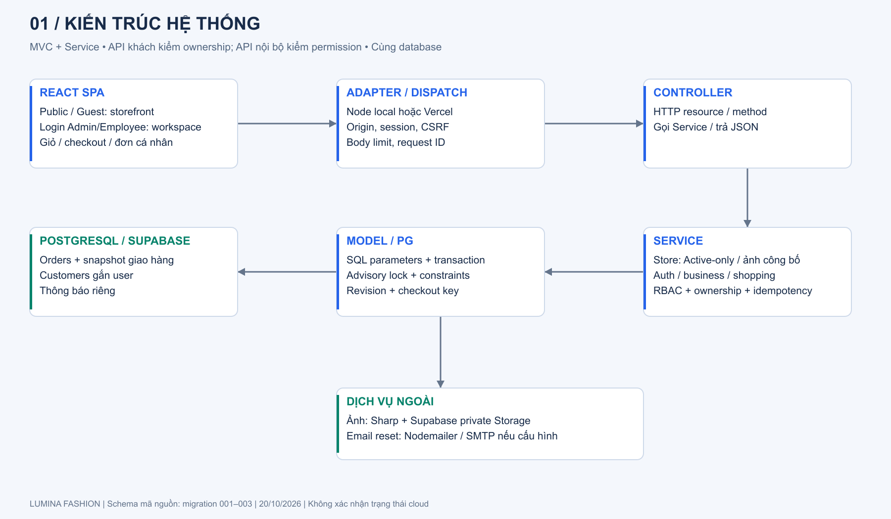
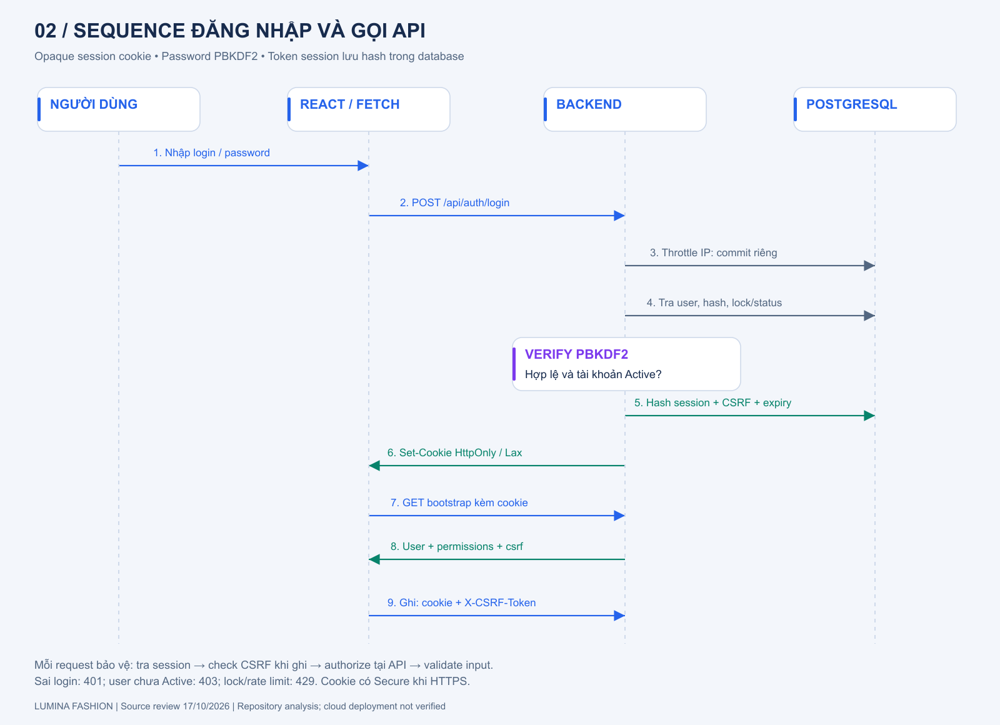
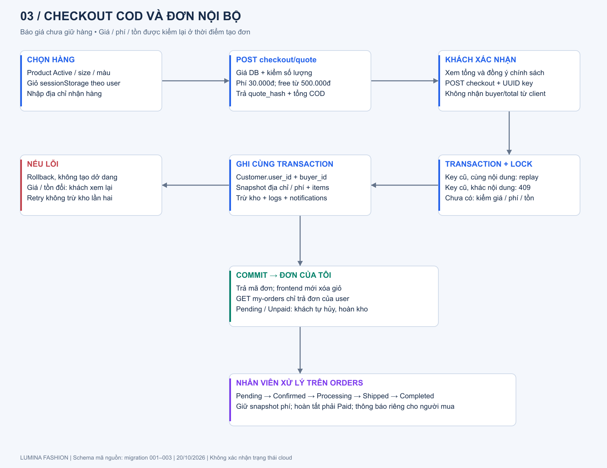
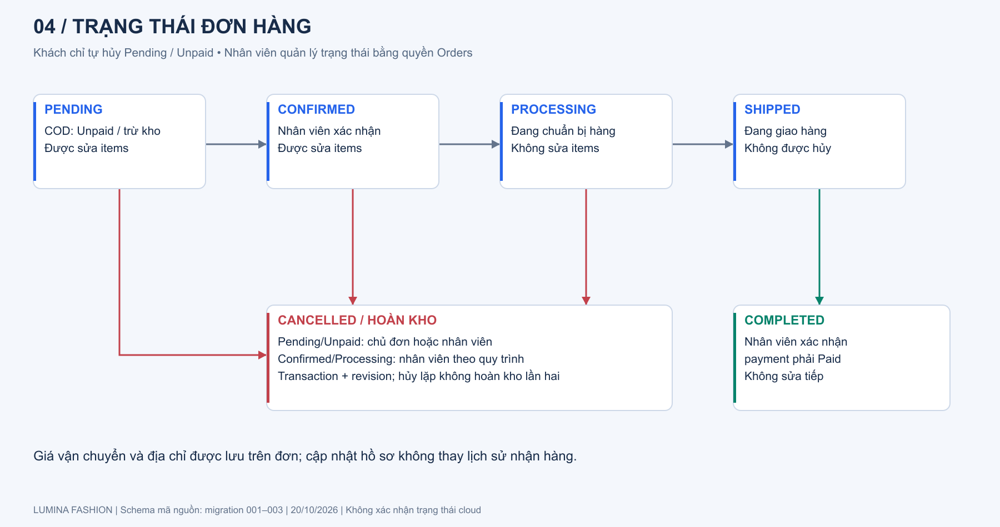
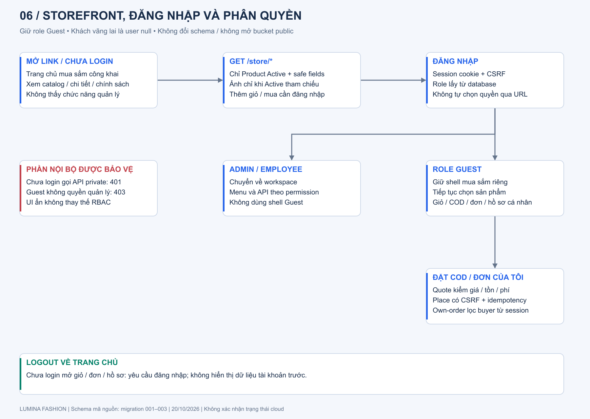
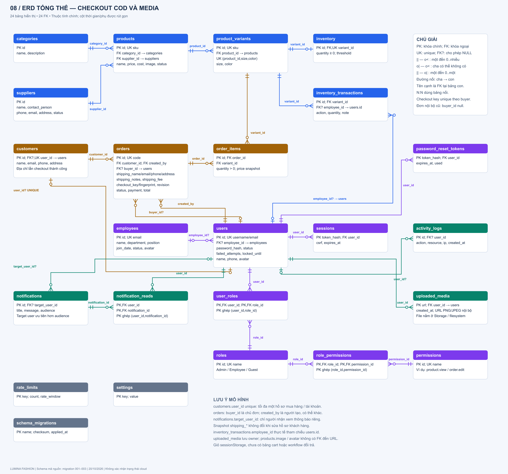
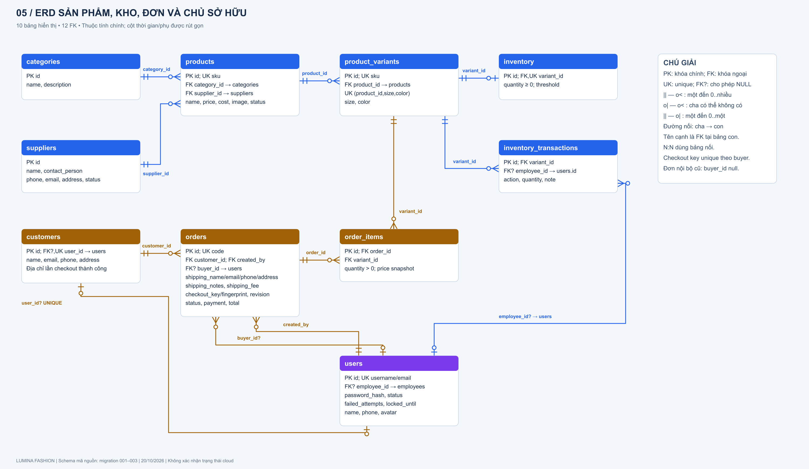
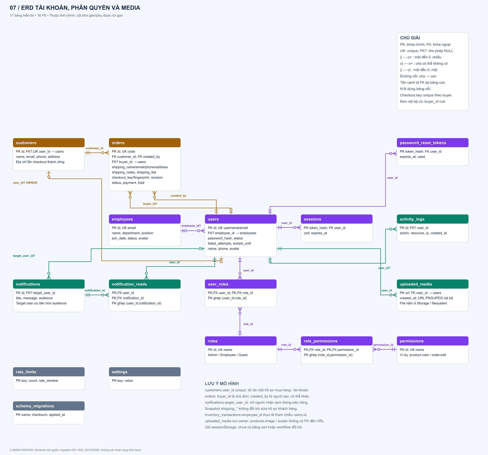

# LUMINA FASHION — Tài liệu ôn tập và bảo vệ đồ án

Ngày cập nhật: **20/10/2026**, đối chiếu công nghệ, luồng hoạt động và schema mã nguồn đến migration 003. ERD hiện có **24 bảng và 24 FK**, gồm bảng ownership ảnh `uploaded_media` và bảng kỹ thuật `schema_migrations`. Xem [mô tả công nghệ, luồng hoạt động và ERD](CONG-NGHE-LUONG-HOAT-DONG-ERD.md) để theo dõi từng bước và dữ liệu đọc/ghi, [ERD Mermaid độc lập](ERD.mmd) để chỉnh sửa sơ đồ.

Phạm vi cloud từng xác minh ngày 17/10: chỉ đọc schema 002, TLS và kết nối runtime trên Supabase; web local và health check hoạt động. Không suy ra migration 003 hoặc Storage/Vercel live đã được xác minh từ lần cập nhật tài liệu này. Kết quả chi tiết và giới hạn nằm trong [kết quả kiểm thử](VALIDATION.md).

## 1. Giới thiệu trong 60–90 giây

> LUMINA FASHION quản lý cửa hàng thời trang và hỗ trợ khách mua hàng COD. Sản phẩm có biến thể size/màu và tồn kho riêng; ba role là Admin, Employee, Guest. Frontend dùng React/TypeScript/Vite, backend Node.js/TypeScript theo MVC mở rộng với Service, PostgreSQL và private Storage trên Supabase. Ứng dụng tự quản lý session cookie/RBAC. Checkout lấy giá/tồn từ DB, chốt phí giao hàng, lưu snapshot địa chỉ, tạo đơn Pending/Unpaid và trừ kho trong transaction. Guest xem đơn cá nhân, tự hủy khi Pending/Unpaid; nhân viên xử lý đơn trên Orders. Retry cùng checkout key không tạo thêm đơn. COD chưa phải thu tiền online; chưa tích hợp payment gateway.

**Tên đề tài phù hợp:** “Website quản lý cửa hàng thời trang LUMINA FASHION và đặt hàng COD với phân quyền, quản lý tồn kho”. Không khẳng định có thanh toán online, tích hợp vận chuyển hoặc đổi trả tự động.

**Giao diện hiện tại:** khách chưa đăng nhập mở link thấy storefront công khai; xem sản phẩm/chi tiết/chính sách không cần tài khoản, thêm giỏ/mua cần login. Role Guest đã đăng nhập dùng cùng shell mua sắm riêng, không render workspace hoặc tải nền module quản lý. Admin/Employee login vào workspace theo quyền. Tên role Guest được giữ nguyên; khách vãng lai user null không phải một role mới. Không cần migration bổ sung cho storefront. Xem [08-STOREFRONT.md](../huong-dan-cau-hinh/08-STOREFRONT.md).

Kiểm chứng storefront: build, 273 lượt embedded (183 integration + 74 checkout/public API + 9 production + 7 DB role), UI storefront/shopping/navigation và 55 URL checks đạt. Đã xem desktop/mobile 390px bằng Edge với dữ liệu giả lập, và smoke test chỉ đọc catalog/policy công khai trên cấu hình Supabase (200), Users chưa login (401). Không tạo đơn thử hoặc đổi dữ liệu cloud; Storage live chưa được xác minh do không có ảnh upload được công bố trong dữ liệu kiểm tra.

## 2. Công nghệ, công cụ và thư viện

Phiên bản dưới đây là **khai báo trong `package.json`**, không phải khẳng định phiên bản thực tế đang được cài hoặc đang chạy trên cloud. Dấu `^` cho phép thay đổi trong phạm vi tương thích theo semver.

| Nhóm | Công nghệ / phiên bản khai báo | Vai trò thực tế |
|---|---|---|
| Ngôn ngữ | TypeScript `^5.9.3`, TSX; SQL; CSS; HTML | Logic frontend/backend, giao diện React, schema và truy vấn |
| Frontend | React và React DOM `19.3.0` | SPA, component, state, effect, render giao diện |
| Build / dev server | Vite `^8.3.4`, plugin React `^6.0.2` | Chạy frontend local, proxy `/api`, build asset production |
| Backend runtime | Node.js `24.x` trong engines | HTTP server local và runtime API khi deploy |
| API | `Request`, `Response`, `fetch`, `node:http` | Router/controller tự xây dựng, giao tiếp JSON, multipart upload |
| Database | PostgreSQL | Lưu nghiệp vụ, quan hệ, constraint, transaction, index |
| Driver DB | `pg ^8.23.1` | Connection pool, SQL parameters, giao dịch |
| Cloud DB / file | Supabase; SDK `^2.117.3` | PostgreSQL qua `pg`; SDK dùng cho Storage private |
| Hosting | Vercel; `@vercel/functions ^3.9.11` | Phục vụ frontend tĩnh, Node.js Function, lấy IP qua adapter |
| Validation | Zod `^4.6.6` | Kiểm tra input, enum, giới hạn, chuẩn hóa dữ liệu |
| Biểu đồ | Recharts `^3.8.0` | Dashboard và biểu đồ doanh thu |
| Icon | Lucide React `^1.55.0` | Icon giao diện |
| Xử lý ảnh | Sharp `^0.35.5` | Decode/re-encode PNG/JPEG, loại metadata/payload dư |
| Email | Nodemailer `^10.1.0` | Gửi email đặt lại mật khẩu nếu đã cấu hình SMTP |
| Biến môi trường | dotenv `^18.0.7`; Node `--env-file` | Nạp cấu hình server, tách secrets khỏi frontend |
| Chạy TS | tsx `^4.20.6` | Chạy TypeScript trực tiếp bằng `node --import tsx` |
| Test DB | PGlite `^0.5.8`, pglite-socket `^0.2.11` | PostgreSQL WASM tạm trong RAM, truy cập TCP cho test |
| Test DOM | jsdom `^30.1.2`, Node assert | Kiểm tra UI/điều hướng/giỏ và integration theo script |
| Quản lý gói | npm; package-lock.json | Cài dependency xác định bằng `npm ci` |
| Source / CI | Git, cấu hình GitHub Actions và Dependabot | Quản lý phiên bản, CI build/test/audit, đề xuất cập nhật dependency |
| IDE / thao tác kiểm tra | VS Code, Browser DevTools | Chỉnh sửa khi phát triển, kiểm tra Network/Application/Console |

**Các điều cần gọi đúng tên:** React là thư viện UI; Vite là công cụ build; Node.js là runtime; TypeScript kiểm tra kiểu lúc phát triển; PostgreSQL là DBMS; Supabase và Vercel là nền tảng dịch vụ. Backend hiện không dùng Express, NestJS hay Next.js; không có ORM Prisma/Sequelize; không dùng Supabase Auth. Không thấy framework CSS Tailwind/Bootstrap trong dependencies: giao diện dùng CSS riêng.

Không thể suy ra tác giả ban đầu, giấy phép hay mức độ tự viết chỉ từ cấu trúc repo. Khi được hỏi “mã nguồn lấy ở đâu?”, cần trình bày trung thực phần tự làm/kế thừa/tham khảo dựa trên lịch sử làm việc và trích dẫn của nhóm.

## 3. Tổ chức mã nguồn và kiến trúc

| Đường dẫn | Trách nhiệm | Ví dụ để giải thích |
|---|---|---|
| `frontend/src/main.tsx` | Khởi tạo React | Entry frontend |
| `frontend/src/App.tsx` | Bootstrap, trạng thái user, menu, điều hướng hash | `#products`, `#orders/12`; không dùng React Router |
| `frontend/src/components/lumina/storefront.tsx` | Shell mua sắm riêng cho khách vãng lai và Guest | Home, card grid, filters, login gate, đơn/hồ sơ cá nhân |
| `backend/src/services/storeService.ts`, `models/storeModel.ts` | Projection công khai và điều kiện công bố ảnh | Active-only, không cost/supplier/số lượng kho |
| `frontend/src/components/lumina/` | Các View | Auth, dashboard, CRUD, inventory, orders, reports, shopping |
| `frontend/src/styles.css` | CSS ứng dụng | Layout, responsive, component styles |
| `frontend/src/lib/client.ts` | Wrapper gọi API, CSRF, format tiền/ngày, CSV | `fetch('/api/...')` |
| `frontend/src/lib/cart.ts` | Giỏ hàng theo user trong sessionStorage | Một dòng cho mỗi variant, tối đa 99 |
| `shared/entities.ts` | Metadata entity và field | Dùng chung cho form và validation, không chứa secrets |
| `backend/src/app.ts` | Cổng xử lý request chung | Origin, IP tin cậy, body limit, content type, request ID |
| `backend/src/routes/apiRoutes.ts` | Điểm nối routing | File này hiện chuyển tiếp sang controller; dispatch resource nằm trong controller |
| `backend/src/controllers/apiController.ts` | Điều phối HTTP/API | Đọc path/method, current user, gọi service, trả JSON |
| `backend/src/services/` | Nghiệp vụ và validation | Auth, CRUD, đơn hàng, kho, báo cáo, email |
| `backend/src/models/` | SQL và persistence | `catalogModel`, `businessModel`, `authModel`, transaction |
| `backend/src/middleware/security.ts` | Auth/session/RBAC/CSRF/password | `authorize`, `currentUser`, `startSession` |
| `backend/src/config/runtime.ts` | Config và adapter lưu ảnh | Supabase Storage hoặc filesystem local |
| `backend/src/server.ts` | Node HTTP server local | API, static frontend build, `/healthz` |
| `api/index.ts` | Adapter Vercel | Rewrite request, lấy IP, gọi cùng `dispatch` |
| `database/migrations/001_initial.sql` | Schema ban đầu | Bảng, FK, unique, check, index |
| `backend/scripts/` | Tác vụ vận hành chủ động | Migrate, seed, runtime role, import SQLite cũ |
| `.github/workflows/ci.yml` | Pipeline CI | `npm ci` → `test:embedded` → audit production dependencies |
| `tests/` | Script kiểm thử | Integration, production, UI, navigation, seed, request URL |

### MVC được áp dụng thế nào?

- **View:** React component hiển thị và nhận thao tác người dùng.
- **Controller:** Nhận HTTP, kiểm tra ngữ cảnh, phân nhánh endpoint, trả Response.
- **Service:** Quy tắc nghiệp vụ: có được chuyển trạng thái không, có đủ hàng không, tính tổng đơn như thế nào.
- **Model:** Truy vấn PostgreSQL và thao tác dữ liệu.

Đây là SPA kết hợp API theo MVC mở rộng với Service; View nhận JSON và render tại trình duyệt, không phải MVC dùng template server. Một số logic vẫn nằm trong controller và middleware có re-export helper DB; mức phân lớp hiện tại chưa hoàn toàn nghiêm ngặt. TypeScript vẫn có nhiều `any`, nên runtime validation bằng Zod vẫn cần thiết.

## 4. Luồng hoạt động tổng thể

### 4.1. Mở ứng dụng và đăng nhập

1. Trình duyệt tải HTML/CSS/JS; React gọi `GET /api/bootstrap`.
2. Backend tìm cookie `lumina_session`; SHA-256 token để tra session trong DB; kiểm tra session còn hạn và user Active; nạp role/permissions.
3. Chưa đăng nhập: bootstrap trả user null, frontend hiện trang chủ mua sắm và tải catalog công khai. Bấm Đăng nhập hoặc thêm giỏ/mua mới mở form auth; chính sách và chi tiết được xem công khai.
4. Người dùng gửi `POST /api/auth/login` với username/email, password, remember.
5. Backend kiểm tra rate limit IP, input, mật khẩu PBKDF2, thời gian khóa và trạng thái tài khoản.
6. Thành công: tạo token ngẫu nhiên 32 byte, lưu **hash token** vào DB cùng CSRF token và expiry; trả cookie HttpOnly, SameSite=Lax, Secure khi HTTPS.
7. Frontend gọi lại bootstrap, lưu user/CSRF. Guest ở storefront và có thể tiếp tục sản phẩm đang chọn; Admin/Employee được điều hướng về workspace theo permissions.
8. Request ghi gửi `X-CSRF-Token`; backend xác thực và phân quyền lại, không tin quyền do UI cung cấp.

Session thường có hạn DB 8 giờ; remember 30 ngày và có Max-Age cookie. Session không remember dùng cookie phiên trình duyệt, nhưng DB vẫn có expiry 8 giờ. Đây là opaque session, không phải JWT, không phải đăng nhập bằng Supabase Auth.

### 4.2. Một thao tác CRUD, ví dụ thêm sản phẩm

View mở form từ metadata → người dùng nhập → frontend gửi JSON và CSRF → `dispatch` kiểm tra request → transaction → controller xác định user/resource → Service yêu cầu `product.create`, validate field, kiểm tra giá vốn không lớn hơn giá bán → Model chạy INSERT với parameters → ghi audit → commit → trả JSON → UI tải lại danh sách. Có lỗi: response phù hợp và rollback request, trừ ngoại lệ login giữ lại bộ đếm thất bại.

### 4.3. Đăng ký, duyệt và khôi phục mật khẩu

- Đăng ký: validate thông tin và điều khoản, chống username/email trùng → hash password → tạo **Guest + Pending** → thông báo cho Admin. Chưa được đăng nhập cho đến khi Admin duyệt Active.
- Quên mật khẩu: trả thông báo chung để hạn chế lộ email tồn tại; nếu user tồn tại tạo token ngẫu nhiên, lưu hash, hiệu lực 15 phút. SMTP đã cấu hình mới gửi email thật; demo có thể trả reset URL.
- Reset: kiểm tra token, hạn và trạng thái dùng → đổi password → kết thúc session và vô hiệu reset liên quan; token chỉ dùng một lần.
- Đổi mật khẩu trong profile: yêu cầu mật khẩu cũ; giữ phiên hiện tại, kết thúc các phiên khác.
- Logout: xóa session hiện tại trong DB và hết hạn cookie.

### 4.4. Sản phẩm và tồn kho

Product chứa tên/SKU chung, danh mục, nhà cung cấp, giá bán/giá vốn và trạng thái Active/Draft/Archived. Variant chứa SKU riêng, size, màu. Mỗi variant có tối đa một hàng inventory nhờ unique `variant_id`.

- Stock In: cộng số lượng.
- Stock Out: trừ số lượng, không cho âm kho.
- Adjustment: đặt tồn thực tế sau kiểm kê; lịch sử lưu phần chênh lệch so với tồn cũ.
- Mọi thay đổi nghiệp vụ kho có lịch sử theo variant và người thực hiện. Cột `inventory_transactions.employee_id` thực tế FK đến **users**, dù tên cột là employee_id.
- Phân loại: `quantity = 0` → Out of Stock; `quantity <= threshold` → Low Stock; còn lại In Stock. Threshold mặc định 10.

### 4.5. Tạo, sửa và hủy đơn nghiệp vụ

1. Admin/Employee có `order.create` chọn **customer có sẵn**, variant và số lượng.
2. Server kiểm tra customer, gộp dòng trùng variant, sản phẩm Active và đủ hàng.
3. **Lấy giá từ DB**, tính tổng ở server; không nhận giá hay tổng tiền client làm căn cứ.
4. Trong transaction: tạo order Pending, chèn order_items có snapshot đơn giá, trừ inventory, ghi inventory_transactions, tạo notification và audit.
5. Trả id/mã đơn cho UI.
6. Sửa items chỉ khi Pending/Confirmed: hoàn phần hàng cũ, thay items, trừ phần mới, tính lại tổng; có guard revision/trạng thái.
7. Hủy chỉ từ Pending/Confirmed/Processing: hoàn hàng và tăng revision; không cho hoàn lặp qua hủy lần hai.
8. Shipped chỉ sang Completed; Completed yêu cầu payment Paid; Completed/Cancelled không sửa tiếp.

**Thời điểm trừ kho là khi tạo đơn Pending**, không chờ giao hàng. Việc chọn Bank Transfer/Cash/Card và Paid/Unpaid là ghi nhận nghiệp vụ thủ công, chưa gọi cổng thanh toán.

### 4.6. Đồng thời, transaction và rollback

- `requestTransaction` bọc request trong transaction DB; request ghi lấy `pg_advisory_xact_lock(728341901)` để tuần tự hóa mutation đi qua luồng này trên cùng database.
- `AsyncLocalStorage` giúp các Model trong cùng request dùng đúng DB connection/transaction.
- `db().batch` dùng savepoint, rollback nhóm nếu lỗi; request lỗi cũng rollback ở lớp ngoài, ngoại lệ login được giữ để lưu số lần thất bại.
- CHECK `quantity >= 0` là lớp bảo vệ DB; revision của order chống cập nhật trên bản cũ.
- Đổi lại, advisory lock chung có thể thành nút thắt khi nhiều người ghi cùng lúc. Checkout COD đã có unique `(buyer_id,checkout_key)` và fingerprint để xử lý retry. API tạo đơn nội bộ `/orders` vẫn chưa có idempotency key. Hướng cải tiến: khóa theo hàng, isolation và retry có kiểm soát.

### 4.7. Giỏ hàng và checkout COD

Đăng nhập → lọc/tìm Product Active → chọn variant còn hàng → giỏ → nhập địa chỉ → POST `/checkout/quote` để kiểm giá/tồn/phí → đồng ý chính sách → POST `/checkout` → transaction tạo đơn và trừ kho → xóa giỏ khi thành công → mở `/my-orders/:id`.

Giỏ vẫn dùng state + sessionStorage theo user/tab, tối đa 99/variant và không giữ chỗ trước lúc tạo đơn. Quote chưa giữ hàng; lúc place kiểm lại và yêu cầu xem lại nếu giá/phí đổi. Phí mặc định 30.000đ, miễn phí từ 500.000đ tiền hàng, cấu hình qua env. COD là trả lúc nhận, không gọi payment gateway.

`customers.user_id` liên kết hồ sơ với session user bằng FK+unique, không nối theo email. `orders.buyer_id` là chủ đơn; thông tin shipping và shipping_fee lưu snapshot. API `/my-orders` kiểm ownership, không cấp Guest quyền Orders nội bộ. Đơn cũ buyer_id null không tự gán cho tài khoản.

Checkout key/fingerprint giúp retry trả đúng đơn cũ, không trừ kho hai lần. Khách tự hủy Pending/Unpaid; hoàn kho có guard trong transaction. Thông báo riêng dùng `notifications.target_user_id`, không phát đơn cá nhân cho mọi Guest. Địa chỉ lần đặt thành công được điền lại; sửa customer không thay địa chỉ trên đơn cũ. Chính sách có trang riêng, đổi trả 7 ngày do cửa hàng xử lý, chưa có workflow hoàn tiền tự động. Chi tiết: [07-SHOPPING.md](../huong-dan-cau-hinh/07-SHOPPING.md).

## 5. Vai trò và chức năng

Ma trận dưới đây là **quyền mặc định khi khởi tạo**, không phải snapshot quyền đang có trong database đang triển khai. Admin có thể chỉnh một số permission Employee/Guest trong giới hạn backend.

| Chức năng | Admin | Employee mặc định | Guest mặc định |
|---|---|---|---|
| Đăng nhập/logout, profile, đổi mật khẩu | Có | Có | Có sau duyệt Active |
| Dashboard / shell | Workspace đầy đủ | Workspace nghiệp vụ | Storefront khách mua riêng, không hiện dashboard quản lý |
| Xem sản phẩm | Có | Có | Chỉ Active; ẩn dữ liệu nội bộ |
| Tạo/sửa/xóa sản phẩm | Có | Không mặc định | Không |
| Thêm variant size/màu/SKU | Có | Không mặc định | Không |
| Xem danh mục | Có | Có | Không có API danh mục riêng theo quyền mặc định |
| Quản lý danh mục | Có | Không | Không |
| Xem/nhập/xuất/điều chỉnh/lịch sử kho | Có | Có | Không |
| Xem/tạo/sửa/hủy đơn đúng quy trình | Có | Có | Không |
| Xem khách hàng và lịch sử đơn qua customer detail | Có | Có | Không |
| Tạo/sửa/xóa khách hàng | Có | Không | Không |
| Xem/quản lý nhà cung cấp | Có | Không | Không |
| Xem/quản lý nhân viên | Có | Không | Không |
| Users: tạo, duyệt Pending, role, trạng thái, đặt lại password | Có | Không | Không |
| Roles & Permissions | Có, chỉnh role Employee/Guest trong giới hạn | Không | Không |
| Reports, lọc ngày, CSV | Có | Không | Không |
| Xem thông báo phù hợp audience, đánh dấu đã đọc | Có | Có | Có |
| Tạo/sửa/xóa thông báo | Có | Không | Không |
| Activity Logs và CSV | Có | Không | Không |
| Tìm kiếm toàn hệ thống | Theo quyền | Theo quyền | Sản phẩm Active |
| Giỏ hàng, báo giá và checkout COD | Có nếu xem được sản phẩm | Có nếu xem được sản phẩm | Có nếu xem được sản phẩm |
| Đặt COD, xem đơn của mình | Có, qua API khách riêng | Có, qua API khách riêng | Có, qua API khách riêng |
| Tự hủy đơn của mình Pending/Unpaid | Có | Có | Có |
| Chính sách và địa chỉ lần mua trước | Có | Có | Có |

Khách chưa login (user null) xem home/catalog/chi tiết/chính sách và ảnh sản phẩm Active qua `/api/store/*`; thêm giỏ, checkout, hồ sơ, đơn cá nhân cần session. Không được mở các module Admin/Employee; backend vẫn từ chối API private độc lập với UI.

### Các chi tiết RBAC dễ nhầm

- Có 23 permission khai báo; 3 role mặc định. `authorize` cho Admin bỏ qua kiểm tra permission thông thường.
- Một số permission bị **khóa Admin-only ở code**: quản lý user/role/nhân viên/nhà cung cấp/danh mục/khách hàng/thông báo, xem báo cáo và audit. Không chỉ phụ thuộc checkbox DB.
- Guest bị giới hạn ở `product.view`, `notification.view`, dù sửa dữ liệu quyền để thêm quyền khác. Các chức năng profile/bootstrap/dashboard có xử lý riêng.
- Admin có thể cấp Employee quyền product create/edit/delete vì các permission này không nằm trong danh sách Admin-only; mặc định Employee chưa có.
- Guest không có trang Categories riêng nhưng dashboard giới hạn vẫn trả thống kê danh mục; sản phẩm vẫn có thông tin danh mục để xem.
- API products thực sự bỏ `cost`, supplier và stock cho Guest; detail variant chỉ có id/SKU/size/color/available. Đây là lọc dữ liệu server, không chỉ ẩn cột UI.
- Dashboard chỉ trả counts sản phẩm, thống kê danh mục và cờ limited khi thiếu `report.view`; số liệu doanh thu/nhân viên/khách hàng chỉ được nạp sau kiểm tra quyền này. Employee mặc định không có `report.view`.
- Thông báo có audience All/Admin/Employee/Guest; trạng thái đã đọc được lưu riêng theo user qua notification_reads.
- UI ẩn nút chỉ giúp trải nghiệm; backend kiểm tra quyền mới là biện pháp bảo vệ thật.

## 6. Cơ sở dữ liệu và ERD

Migration 001 tạo **22 bảng / 20 FK**; runner tạo thêm `schema_migrations`. Migration 002 thêm 3 FK cùng các cột/index checkout, không tạo bảng mới. Migration 003 thêm `uploaded_media` và FK `user_id` tới users. Tổng schema mã nguồn hiện có **23 bảng ứng dụng + 1 bảng migration = 24 bảng, 24 FK**. Đây là mô hình sau khi áp đủ migration, không phải xác nhận schema cloud hiện tại.

| Nhóm | Bảng | Ý nghĩa |
|---|---|---|
| Catalog | categories, suppliers, products, product_variants | Phân loại, nguồn hàng, mẫu sản phẩm, size/màu |
| Kho | inventory, inventory_transactions | Tồn hiện tại và lịch sử thay đổi |
| Bán hàng | customers, orders, order_items | Khách, đầu đơn, chi tiết đơn |
| Nhân sự/tài khoản | employees, users | Hồ sơ nhân viên và tài khoản đăng nhập |
| RBAC | roles, permissions, user_roles, role_permissions | Quan hệ nhiều-nhiều role/user và role/permission |
| Xác thực | sessions, password_reset_tokens, rate_limits | Phiên đăng nhập, reset một lần, hạn tần suất |
| Hệ thống | notifications, notification_reads, activity_logs, settings | Thông báo, đã đọc, audit, cấu hình seed |
| Ảnh | uploaded_media | URL upload và tài khoản sở hữu; bytes nằm ngoài DB |
| Migration | schema_migrations | Tên file, SHA-256 checksum, thời điểm apply |

Mô tả từng quan hệ, cardinality, khóa ghép và bảng đọc/ghi theo nghiệp vụ: [công nghệ, luồng hoạt động và ERD](CONG-NGHE-LUONG-HOAT-DONG-ERD.md#8-erd-tổng-thể-và-cách-đọc). Mã sơ đồ riêng: [ERD.mmd](ERD.mmd).

Quan hệ chính:

- Category 1–N Product; Supplier 1–N Product; Product 1–N Variant.
- Variant 1–0..1 Inventory theo FK+unique, nghiệp vụ tạo variant đi kèm inventory; Variant 1–N InventoryTransaction và 1–N OrderItem.
- Customer 1–N Order; Order 1–N OrderItem theo nghiệp vụ; User 1–N Order qua created_by.
- Employee 1–N User theo schema hiện tại: employee_id nullable và chưa UNIQUE, do đó không tuyên bố quan hệ 1–1.
- User N–N Role qua user_roles; Role N–N Permission qua role_permissions. UI/nghiệp vụ hiện gán một role/user, nhưng schema có thể biểu diễn nhiều role.
- User 1–N Session/ResetToken/AuditLog; User N–N Notification qua notification_reads.
- User 1–0..1 Customer qua customers.user_id unique nullable; User 1–N Order qua buyer_id nullable (khác created_by); User 1–N Notification riêng qua target_user_id nullable. Các liên kết mới không tự gán dữ liệu lịch sử theo email.
- User 1–N uploaded_media qua user_id NOT NULL; URL là PK. Các trường image/avatar là text, không có FK tới uploaded_media; backend kiểm quyền khi gán/đọc. inventory_transactions không có FK order_id, liên hệ mã đơn qua note.

**Ràng buộc:** PK, FK, unique username/email dạng lower, SKU sản phẩm/variant duy nhất, bộ product_id+size+color duy nhất, inventory.variant_id duy nhất, số lượng kho không âm, quantity chi tiết đơn >0, total >=0. Tiền dùng `numeric(14,2)`; driver chuyển sang Number theo giới hạn ứng dụng. Không nên khẳng định mọi phép toán tiền đã dùng decimal chuyên dụng ở tầng JS.

**Vì sao tách product/variant?** Cùng một mẫu áo có nhiều size và màu; mỗi tổ hợp cần SKU và tồn kho riêng. **Vì sao tách order/order_items?** Một đơn có nhiều dòng; lưu đơn giá từng dòng để giá bán cũ không bị thay bởi giá sản phẩm mới. Tuy nhiên khi sửa lại items, service hiện lấy lại giá hiện tại từ DB.

**Báo cáo cần giải thích đúng:** doanh thu dựa trên đơn Completed; lọc kỳ theo `orders.created_at`, không có cột completed_at dùng cho báo cáo. Lợi nhuận gộp hiện tính `(order_items.price - products.cost hiện tại) × quantity`, chưa lưu snapshot giá vốn, nên đổi cost có thể đổi lợi nhuận lịch sử. Báo cáo Inventory là tồn hiện tại, không phải tồn tại thời điểm cuối kỳ.

## 7. API tiêu biểu

Các đường dẫn dưới đây có prefix `/api`; không phải tài liệu OpenAPI được sinh tự động. Backend tự dispatch resource/method trong controller.

| Method / endpoint | Công dụng | Quyền chính |
|---|---|---|
| GET /bootstrap | User hiện tại, csrf và cờ demo | Cho phép chưa login |
| GET /store/products[/:id], /store/policy | Catalog Active/chi tiết và chính sách | Công khai chỉ đọc, projection whitelist |
| GET /store/media/:key | Ảnh đang gắn sản phẩm Active | Công khai có kiểm tra tham chiếu; không mở bucket |
| POST /auth/login, /register, /forgot, /reset | Auth công khai có giới hạn | Validate, origin/rate limit |
| POST /auth/logout, /change-password | Kết thúc/đổi phiên | Session và CSRF |
| GET /dashboard | Chỉ số theo role | Đã login |
| GET, PUT /profile | Hồ sơ chính mình | User từ session; PUT cần CSRF |
| GET /products; GET /products/:id | Danh sách/chi tiết | product.view + lọc Guest |
| POST, PUT, DELETE /products[/:id] | Quản lý sản phẩm | product.create/edit/delete |
| POST /products/:id/variants | Thêm biến thể và tồn đầu | product.edit |
| CRUD /categories, /suppliers, /customers, /employees, /users | Quản lý entity | Mapping quyền tương ứng |
| GET, POST /inventory; GET /inventory/history | Tồn và thay đổi kho | inventory.view/edit |
| GET /orders; GET /orders/:id; POST /orders | Xem/tạo đơn | order.view/create |
| PUT /orders/:id; PUT /orders/:id/items | Cập nhật trạng thái/items | order.edit + quy tắc nghiệp vụ |
| GET, PUT /roles | Quyền và gán quyền theo role | role.manage, Admin |
| CRUD /notifications; POST /notifications/:id/read | Thông báo và trạng thái đọc | notification.view/manage + audience |
| GET /reports?from=...&to=... | Báo cáo | report.view, Admin |
| GET /activity | Audit gần đây | activity.view, Admin |
| GET /search?q=... | Search resource được cấp quyền | Kiểm tra từng resource |
| GET /shop-policy; GET /checkout/address | Chính sách và địa chỉ cá nhân đã lưu | Session |
| POST /checkout/quote; POST /checkout | Báo giá server và đặt COD có idempotency | product.view + session + CSRF |
| GET /my-orders[/:id]; POST /my-orders/:id/cancel | Xem/hủy đơn cá nhân đủ điều kiện | Ownership theo session; POST cần CSRF |
| POST /upload; GET /media/:key | Tải/lấy ảnh qua backend | Session; upload cần CSRF; đọc/gán ảnh cần owner hoặc quyền đối với bản ghi tham chiếu |

HTTP hay hỏi: 400 input/JSON sai; 401 chưa xác thực; 403 không có quyền/CSRF/origin; 404 không tìm thấy; 409 xung đột/trùng/liên kết/tồn kho/revision; 413 body quá lớn; 415 content type sai; 422 validation/nghiệp vụ; 429 rate limit/lock; 500/503 lỗi server/dịch vụ. CRUD hiện có nhiều response thành công dùng 200, không mặc định mọi POST đều 201.

## 8. Bảo mật: đã làm gì và giới hạn ở đâu?

**Kiểm thử bổ sung 20/10/2026:** [Báo cáo khắc phục và rủi ro còn lại](BAO-CAO-BAO-MAT-OWASP.md) có bằng chứng trước/sau cho 5 vấn đề mới: đổi email thiếu reauthentication, token/session còn sống sau đổi email, phản hồi SMTP/register làm lộ định danh và URL mã hóa lỗi. Sau vá đạt 13 kiểm tra mới, tổng backend 344 lượt; UI/URL đạt, audit hiện tại 0 advisory. Rủi ro còn mở gồm email verification, timing/queue SMTP, MFA/password policy, quota/abuse, cleanup file, alert và ngoại lệ CSP. Chưa xác minh cloud trong lần này. Những số liệu 17/10 dưới đây là lịch sử.

Bản rà soát bổ sung ngày 17/10/2026: xem [Báo cáo bảo mật OWASP](BAO-CAO-BAO-MAT-OWASP.md) để biết từng vấn đề, mức độ, file sửa và kết quả kiểm thử. Đã sửa alias URL né rate limit, ownership ảnh, dashboard vượt quyền và thu hồi reset token; gia cố SMTP TLS, rollback, input, log/header và pin SHA cho CI. Backend có 331 lượt kiểm tra ghi nhận ở các suite hiện tại, gồm 58 lượt security mới. Migration `003_media_ownership.sql` cần áp dụng bằng connection quản trị trước triển khai bản vá; chưa chạy migration này lên cloud trong lần rà soát.

| Rủi ro / chủ đề | Biện pháp thấy trong source | Cách trình bày khi bảo vệ |
|---|---|---|
| Mật khẩu lộ | PBKDF2-HMAC-SHA256 600.000 vòng, salt riêng, verify; nâng hash legacy sau login | Hash một chiều; không lưu plaintext và không giải mã password |
| Đánh cắp session | Token 32 byte ngẫu nhiên, hash SHA-256 lưu DB, expiry, cookie HttpOnly/Secure/Lax | Cookie vẫn được browser tự gửi; HttpOnly chỉ chặn JS đọc cookie |
| CSRF | SameSite, check Origin, sec-fetch-site, X-CSRF-Token cho write có user | CSRF token không phải session token, bootstrap trả cho frontend cùng phiên |
| Vượt quyền/IDOR | authorize tại API, profile lấy id từ session, Guest lọc trường/audience | Thay URL/gọi fetch trực tiếp vẫn phải qua kiểm tra backend |
| SQL injection | Bound parameters; identifier/field lấy từ allowlist | Không coi escape chuỗi là thay thế cho parameterized query |
| XSS | React escape text, CSP, không dùng HTML input tùy ý để render | Giảm rủi ro, không phải bằng chứng không thể XSS |
| CSV formula injection | Prefix dữ liệu nguy hiểm và quote CSV trong client | Chặn công thức bắt đầu =,+,-,@ và control characters theo helper |
| Brute force | Khóa tài khoản sau 5 lần sai trong cơ chế hiện có, 15 phút; IP throttle persistent DB | Login giới hạn 15 request/IP/cửa sổ 15 phút; register/forgot/reset 8 |
| Upload nguy hiểm | PNG/JPEG, kiểm signature/MIME, Sharp decode/re-encode, tên ngẫu nhiên | File tối đa 2 MiB; request body tối đa 3 MiB; ảnh có giới hạn pixel |
| Lộ file / path traversal | Key ảnh regex, validate đường dẫn; local server chặn file nhạy cảm | Không đưa `.env`/key vào báo cáo hoặc bundle |
| DB/cloud | SSL production và rejectUnauthorized; schema private; runtime role ít quyền; RLS server_only | RBAC user nằm ở backend, policy server_only không phân quyền từng người dùng |
| Sửa dữ liệu dở dang | Transaction, savepoint, advisory lock, constraint, revision | Không trừ kho hoặc tạo đơn nửa chừng khi mutation lỗi |
| Audit và lỗi | Activity log, X-Request-ID, lỗi generic, log không in body/password | Chưa có alert tập trung/SIEM, DB admin vẫn có quyền quản trị logs |
| Supply chain | Lockfile, npm ci, audit cả dev trong CI, Dependabot, action pin SHA | Audit tại lần rà soát bảo mật: 0 advisory; không thay thế review mã và kiểm tra vận hành |

`docs/huong-dan-cau-hinh/04-OWASP.md` tổ chức theo **OWASP Top 10:2025**. Khi giảng viên dùng 2021, phải nói rõ phiên bản, không nhầm số thứ tự giữa hai bản. Tài liệu này không xác nhận dự án “đạt chứng chỉ OWASP” hay “bảo mật tuyệt đối”.

Giới hạn hiện tại: chưa MFA/SSO, chưa payment gateway, chưa rate limit tổng thể cho mọi API/WAF riêng, chưa load test/pentest đầy đủ. CSP Vercel còn `style-src 'unsafe-inline'`; local HTTP server khai báo CSP chặt hơn. Không suy ra cấu hình cloud thật đã đúng từ file cấu hình mẫu.

## 9. Chạy local, build, deploy và CI

### Local

- `npm ci`: cài từ lockfile.
- `npm run dev:server`: backend tại port mặc định 3000, watch TypeScript.
- `npm run dev`: Vite tại 5173, proxy `/api` đến 127.0.0.1:3000.
- `npm run build`: `tsc --noEmit` rồi Vite build → `frontend/dist`.
- `npm start`: Node phục vụ frontend đã build và API.
- `db:migrate`, `db:seed`, `db:seed:fashion`, `db:role`, `db:import`: tác vụ database, chỉ chạy chủ động với đúng môi trường. Không cần chạy các lệnh ghi DB để đọc tài liệu này.

### Production theo cấu hình repository

Browser → Vercel static frontend; `/api/*` rewrite đến `api/index.ts` → cùng backend dispatch/controller/service/model → PostgreSQL Supabase qua `pg`; ảnh private qua Storage SDK; SMTP là dịch vụ ngoài nếu cấu hình. Adapter API không listen server dài hạn, không tự migration/seed mỗi request. `vercel.json` khai báo function maxDuration 30 giây; đó là cấu hình repo, không phải cam kết quota mọi gói Vercel.

Database và ảnh cần lưu bền ở ngoài Function. Secrets chỉ có ở môi trường backend. Khóa Storage server không gửi cho frontend. API và frontend cùng origin giúp cookie/CSRF đơn giản hơn; không cần mở CORS tùy ý.

CI hiện có: push/PR → GitHub Actions → Node 24 → npm ci → test:embedded (bao gồm build) → npm audit production dependencies mức high. Dependabot có lịch hàng tuần. Deploy GitHub→Vercel phụ thuộc cấu hình kết nối tài khoản thực tế, chưa được xác minh trong lần đọc này.

## 10. Kiểm thử và chứng cứ

| Script | Kiểm tra gì | Lưu ý |
|---|---|---|
| typecheck/build | Kiểu TypeScript, bundle frontend | Build thành công không đồng nghĩa tất cả nghiệp vụ đúng |
| test:embedded | Build + integration/production/runtime role với DB tạm | Không dùng dữ liệu cloud, có cổng local cần trống |
| test:integration | API, auth, role, CRUD, kho, đơn, rollback | Có hàng rào DB test; không đưa connection production vào |
| test:production | Hành vi cấu hình production | Harness local có giả lập/điều chỉnh transport |
| test:shopping | UI shopping với API giả lập | Không chứng minh giao dịch thanh toán thật |
| test:navigation | Điều hướng, response cũ, trạng thái trang | API giả lập |
| test:request-url | Host/origin/request URL | Tập trung adapter URL |
| test:seed:fashion | Seed dữ liệu fashion | Xem script trước khi chạy |

Lần cập nhật 17/10/2026 đã chạy `test:embedded`: 183 integration + 53 checkout + 9 production + 7 DB role = 252 lượt ghi nhận, kèm assertion nghiệp vụ/upgrade. Shopping UI, navigation và 55 kiểm tra request URL cũng đạt. Snapshot 07/10 từng ghi 179 lượt và audit 0 advisory; chưa chạy audit mới nên không dùng con số đó làm kết quả hiện tại. Đã xác minh TLS/schema/runtime Supabase sau nâng cấp; chưa kiểm tra live Storage/Vercel hoặc load test/pentest/visual QA trình duyệt thật; xem [kết quả kiểm thử](VALIDATION.md).

## 11. Bộ câu hỏi giảng viên có thể hỏi và gợi ý trả lời

### Kiến trúc và lựa chọn công nghệ

1. **Đề tài giải quyết vấn đề gì?** Quản lý dữ liệu cửa hàng thống nhất, theo dõi biến thể/tồn, giảm sai sót xử lý đơn, phân quyền và xem báo cáo.
2. **Vì sao React?** Component tái sử dụng cho form/table/modal/dashboard; state cập nhật giao diện theo dữ liệu API. Không khẳng định React luôn nhanh hơn mọi công nghệ.
3. **Vì sao TypeScript?** Kiểm tra kiểu trước runtime, hỗ trợ refactor; vẫn cần Zod vì HTTP là dữ liệu ngoài và source còn nhiều any.
4. **Vite làm gì?** Dev server, proxy API, build và đóng gói frontend; không thay backend/database.
5. **Node.js khác Express/Next.js thế nào?** Node là runtime; dự án dùng node:http và Web Request/Response, router tự viết; chưa dùng hai framework đó.
6. **MVC nằm ở đâu?** View React, Controller apiController, nghiệp vụ ở Service, SQL ở Model; JSON nối frontend/backend.
7. **Luồng từ nút Lưu đến database?** View→client.fetch→dispatch→transaction→controller→authorize/validation/service→model SQL→audit→commit→JSON→reload UI.
8. **Tại sao frontend/backend cùng repo nhưng tách thư mục?** Dễ quản lý và chia sẻ metadata trong một repo, vẫn tách trách nhiệm; không cần coi là microservices.
9. **Đây có phải REST API chuẩn tuyệt đối?** API theo resource và HTTP method, có JSON/status; có endpoint hành động và tự dispatch, chưa có OpenAPI sinh tự động, nhiều POST trả 200.
10. **SPA chuyển trang bằng gì?** Hash routing thủ công trong App.tsx; không có React Router. Thay hash không yêu cầu server render từng trang.

### Database và nghiệp vụ

11. **Vì sao chọn PostgreSQL?** Nghiệp vụ nhiều quan hệ và cần transaction/constraint/index; giúp bảo vệ tính toàn vẹn kho/đơn.
12. **Supabase được dùng đến đâu?** PostgreSQL được kết nối bằng pg; Storage SDK lưu ảnh private; auth/RBAC do app tự làm.
13. **Sản phẩm khác biến thể?** Mẫu sản phẩm giữ giá/thông tin chung; variant giữ size/màu/SKU và tồn riêng.
14. **Tồn kho lưu ở đâu?** inventory theo variant_id duy nhất; lịch sử ở inventory_transactions, không chỉ ghi đè quantity.
15. **Nhập/xuất/điều chỉnh khác nhau thế nào?** Cộng/trừ theo lượng; Adjustment đặt số thực đếm được và ghi chênh lệch.
16. **Tạo đơn lúc nào trừ kho?** Ngay khi tạo Pending, không chờ Completed; hủy hợp lệ hoàn lại.
17. **Giả sửa giá gửi từ frontend thì sao?** Server không lấy giá/tổng của client làm căn cứ; truy giá DB và tính tổng.
18. **Hai người cùng mua hàng cuối?** Request ghi qua app được advisory lock tuần tự hóa; kiểm tồn trong transaction và CHECK không âm. Không khẳng định khóa này bảo vệ script bên ngoài không đi cùng cơ chế.
19. **Hai người cùng sửa một đơn?** revision và trạng thái trong điều kiện UPDATE; không khớp trả 409 để tải lại, ngoài khóa mutation chung.
20. **Hủy hai lần có hoàn kho hai lần?** Cancelled không cho sửa tiếp; guard status/revision và transaction ngăn hoàn lặp qua luồng API này.
21. **Có chuyển Pending thẳng Completed không?** Không; phải theo transitions. Completed cần Paid, Shipped không cho Cancelled hiện tại.
22. **Có sửa dòng hàng khi đang giao không?** Không; chỉ Pending/Confirmed được sửa items.
23. **Xóa dữ liệu đã liên kết?** FK có thể từ chối và API trả 409; user/employee dùng Disabled/Inactive. Không phải mọi bảng đều soft-delete.
24. **Đổi giá sản phẩm có làm đổi đơn cũ không?** Đơn giá nằm trong order_items; giữ nguyên nếu không sửa items. Sửa items hiện lấy giá DB mới; giá vốn báo cáo vẫn dùng cost hiện tại.
25. **Doanh thu tính theo thời điểm nào?** Đơn Completed, nhưng nhóm/lọc theo ngày tạo order. Không có báo cáo doanh thu theo ngày hoàn tất chuyên biệt.
26. **Inventory trong báo cáo khoảng ngày có phải tồn cuối kỳ?** Không, đó là tồn hiện tại; báo cáo lịch sử tồn cần thiết kế truy hồi riêng.
27. **Chuẩn hóa và index ra sao?** Tách sản phẩm/variant, đầu/chi tiết đơn, role/permission; unique cho SKU/username và index thời gian/variant/session. Không khẳng định mọi truy vấn đã tối ưu nếu chưa EXPLAIN/load test.
28. **User với employee/customer có phải một?** Không. Employee là hồ sơ nhân sự, user là danh tính đăng nhập. Customer liên kết tùy chọn với user qua user_id unique từ migration 002; không tự ghép qua email.

### Xác thực, phân quyền và bảo mật

29. **Authentication khác authorization?** Xác định ai đang gọi bằng session; sau đó kiểm tra người đó được thực hiện quyền nào.
30. **Dùng JWT hay session?** Opaque session cookie; hash token và expiry trong DB; dễ thu hồi khi logout/reset/vô hiệu tài khoản.
31. **Vì sao DB chỉ lưu hash session?** Khi bảng session lộ, hash không trực tiếp là bearer token browser gửi; token có entropy cao. Password vẫn cần PBKDF2 chậm, không chỉ SHA-256.
32. **Hash khác mã hóa?** Hash password dùng kiểm tra một chiều; không có khóa để giải mã. Mã hóa cho phép giải mã khi có khóa.
33. **Salt và PBKDF2 làm gì?** Salt riêng chống cùng password cùng hash; số vòng tăng chi phí thử đoán. Không thay thế password mạnh/rate limit.
34. **HttpOnly/Secure/SameSite có nghĩa gì?** JS không đọc cookie; cookie chỉ qua HTTPS khi có Secure; hạn chế gửi cross-site. Không loại trừ mọi loại tấn công.
35. **Vì sao còn CSRF khi có cookie?** Browser tự gửi cookie nên cần chứng minh request ghi đến từ phiên/trang hợp lệ bằng token và kiểm origin.
36. **Guest gọi API Admin trực tiếp thì sao?** Backend authorize trả 403, chưa login trả 401; ẩn menu không phải hàng rào duy nhất.
37. **Guest có phải người chưa login?** Role Guest vẫn là tài khoản Active đã đăng nhập. Khách vãng lai là user null, cũng có storefront để xem catalog/chi tiết/chính sách qua API public; muốn thêm giỏ/mua phải login.
38. **Đăng ký có chọn Admin được không?** Không; service gán Guest+Pending và cần Admin duyệt.
39. **Employee có thể xin mọi quyền bằng checkbox không?** Không; backend chặn nhóm Admin-only. Một số quyền sản phẩm có thể được Admin cấp thêm.
40. **SQL injection bị ngăn thế nào?** Parameterized SQL cho dữ liệu; entity/column lấy allowlist; không ghép input tùy ý thành SQL.
41. **Chống XSS bằng gì?** Escape text của React, CSP, kiểm dữ liệu/ảnh; vẫn cần đánh giá các ngữ cảnh URL/DOM cụ thể nếu phát triển thêm.
42. **Ảnh giả PNG hoặc SVG có upload được không?** Chỉ PNG/JPEG đúng signature/MIME và decode thành công qua Sharp; giới hạn dung lượng/pixel; SVG không được nhận.
43. **Quên mật khẩu có lộ email không?** Response thông báo chung; token lưu hash, hạn 15 phút và dùng một lần. Email thật cần SMTP cấu hình.
44. **RLS có tự biết role Guest trong app không?** Không. Backend dùng DB runtime role; policy server_only dành cho role đó. RBAC mỗi user nằm ở API.
45. **Đã đạt OWASP chưa?** Có đối chiếu biện pháp và test theo nhóm rủi ro trong docs; không có chứng chỉ hay pentest đầy đủ để tuyên bố đạt toàn bộ.
46. **Log dùng làm gì?** Đối chiếu ai làm gì, lúc nào; request ID nối lỗi với log vận hành. Chưa có cảnh báo tập trung hay log bất biến trước DB admin.

### Deploy, kiểm thử và giới hạn

47. **Vercel chạy frontend/backend thế nào?** Frontend build thành static assets; /api rewrite vào Node Function; dùng cùng backend với local adapter.
48. **Vì sao ảnh/database không để trên ổ đĩa Function?** Cần lưu bền ngoài vòng đời instance; production cấu hình DB và private Storage bên ngoài.
49. **Secrets đặt đâu?** Môi trường backend/Vercel env, không frontend/shared, không commit vào repo công khai. Không trình chiếu .env khi demo.
50. **Connection pool có tác dụng gì?** Tái sử dụng kết nối; max mặc định 2 mỗi pool. Nhiều Function instance vẫn có thể tăng tổng kết nối, cần pooler/quota phù hợp.
51. **Có migration tự chạy trên mỗi request?** Không; chạy bằng script chủ động. Checksum giúp phát hiện file migration đã apply bị thay đổi.
52. **Test có cần cloud thật không?** Embedded dùng PGlite tạm, hữu ích cho API/role/constraint; không chứng minh TLS/Storage/Vercel live đã đạt.
53. **Build chạy là hết bug chưa?** Chưa; chỉ kiểm tra kiểu/bundle. Cần functional/security/integration và test người dùng.
54. **Test suite có được CI chạy hết không?** CI chạy embedded (integration/checkout/public API/production/DB role), shopping, storefront, navigation, request-url và audit. Script test:seed:fashion chưa được gọi riêng trong workflow.
55. **Guest có mua hàng thật không?** Có thể đặt đơn COD qua `/checkout` và xem đơn cá nhân qua `/my-orders`. Không được mở Orders nội bộ; không có thu tiền online.
56. **Chọn Card có trừ thẻ không?** Không; chưa payment provider, webhook, xác minh giao dịch. Paid là trạng thái nghiệp vụ được người có quyền nhập.
57. **Giỏ có tự kiểm tồn và cập nhật giá liên tục không?** Giỏ giữ snapshot; checkout quote lấy giá/tồn mới, place kiểm lại, giá/phí đổi thì 409 yêu cầu xem lại. Quote không giữ hàng.
58. **Gửi lại POST tạo đơn do mạng chậm thì sao?** Checkout COD dùng unique key theo buyer và fingerprint, replay trả đơn cũ, không trừ kho lần hai. API nội bộ `/orders` chưa có cơ chế này. Xóa storage/chuyển thiết bị cần kiểm tra Đơn của tôi trước khi đặt lại.
59. **Điểm yếu khi mở rộng?** Khóa mutation chung, nhiều API list trả toàn bộ rồi lọc/phân trang client, chunk JS lớn theo ghi nhận cũ; cần server pagination, index theo truy vấn, code splitting, load test.
60. **Nếu phát triển tiếp ưu tiên gì?** Payment gateway/webhook, vận chuyển, yêu cầu đổi trả, giỏ backend, snapshot cost, phân trang server, khóa theo hàng, giám sát/backup/MFA và test live. Checkout COD/user–customer/snapshot địa chỉ/idempotency đã được bổ sung.
61. **Em tự làm phần nào?** Trả lời đúng đóng góp thực tế; chỉ ra commit/file/luồng có thể giải thích, công khai phần thư viện hoặc source kế thừa. Không lấy tài liệu này làm bằng chứng tác quyền.
62. **Tại sao nguồn có import SQLite/nhắc D1?** Script import phục vụ chuyển dữ liệu cũ và comment lịch sử; runtime hiện tại dùng PostgreSQL qua pg, không dùng SQLite/D1 làm DB chính.

## 12. Kịch bản demo gợi ý 8–12 phút

1. Mở link khi chưa login: home, tìm/lọc sản phẩm, xem chi tiết/chính sách; bấm thêm giỏ sẽ yêu cầu đăng nhập. Giới thiệu sơ đồ phân chia storefront với workspace và API public/private.
2. Admin: sản phẩm → thêm variant → nhập kho; cho thấy SKU/size/màu và lịch sử.
3. Employee: chọn customer đã có → tạo order với số lượng nhỏ → quan sát kho giảm ngay.
4. Sửa items ở Pending/Confirmed; cho thấy tổng/kho đổi cùng nhau.
5. Dùng một đơn riêng để hủy → kho hoàn; một đơn khác theo đủ trạng thái → Paid+Completed.
6. Admin mở report, lọc ngày, export CSV; giải thích ngày tạo đơn và tồn hiện tại.
7. Login Guest: vẫn là giao diện mua sắm, không có sidebar quản lý; chọn biến thể, nhập địa chỉ, xác nhận COD, xem Đơn của tôi và thử hủy trên dữ liệu demo cho phép. Logout trở về home; login Admin/Employee vào workspace.
8. Dùng Network minh họa Guest gọi `/api/users` hoặc `/api/roles` → 403; logout gọi protected endpoint → 401. Chỉ demo trên môi trường/dữ liệu cho phép.
9. Nếu đủ thời gian: đăng ký → Guest Pending → Admin duyệt; mở Activity Logs đối chiếu.

Chuẩn bị sẵn ba tài khoản Active, một customer, sản phẩm Active có variant còn hàng và các đơn ở trạng thái thích hợp. Không sửa dữ liệu thật chỉ để demo; không mở .env hay hiển thị cookie/token. Không demo thanh toán thành công vì chức năng đó chưa có.

## 13. Những câu nên tránh nói quá

| Tránh nói | Nói đúng theo source |
|---|---|
| “Web dùng Next.js/Express/Supabase Auth” | React+Vite, Node API tự viết, custom session/RBAC |
| “Guest đã thanh toán online” | Guest đặt COD thật, trả tiền khi nhận; chưa có payment gateway |
| “Mọi số liệu đều theo ngày hoàn tất” | Lọc theo ngày tạo order; doanh thu chọn Completed |
| “Lợi nhuận lịch sử luôn chính xác dù đổi giá vốn” | Cost hiện lấy từ product hiện tại, chưa snapshot cost |
| “RLS tự phân quyền từng user ứng dụng” | DB runtime role có server-only policy, user RBAC nằm ở backend |
| “Mọi bảng đều soft delete / employee-user là 1–1” | Chỉ một số entity vô hiệu hóa; schema employee_id chưa unique |
| “Đã test cloud, không có lỗ hổng” | Chỉ khẳng định bằng kết quả thực đo; test local/audit có giới hạn |
| “Giỏ hàng giữ hàng và đồng bộ mọi máy” | sessionStorage theo user/tab, không reserve stock và không sync server |

## 14. Đọc file nào trước buổi bảo vệ?

Ưu tiên: `package.json` → `frontend/src/App.tsx` → `backend/src/app.ts` → `controllers/apiController.ts` → `middleware/security.ts` → `services/businessService.ts` → `models/businessModel.ts` → `models/database.ts` → migration → `shopping.tsx` → `vercel.json`/`api/index.ts` → `docs/bao-ve/VALIDATION.md`.

Sơ đồ PNG được cập nhật cho checkout COD và ownership đến migration 003, gồm **24 bảng và 24 FK**. [ERD.mmd](ERD.mmd) chứa ERD độc lập; `SO-DO.mmd` chứa các khối Mermaid; `tools/render-diagrams.mjs` tạo PNG. [Tài liệu công nghệ và luồng hoạt động](CONG-NGHE-LUONG-HOAT-DONG-ERD.md) mô tả request, đăng nhập, checkout/retry, xử lý/hủy đơn, kho, ảnh và cách các bước dùng bảng dữ liệu. Checkout không cấp quyền Orders nội bộ cho Guest.
