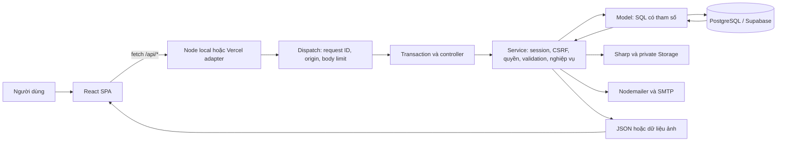
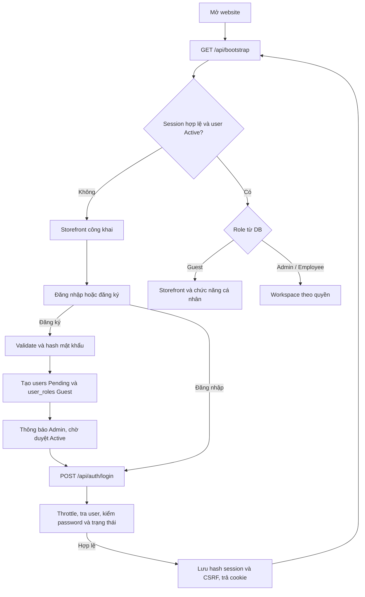
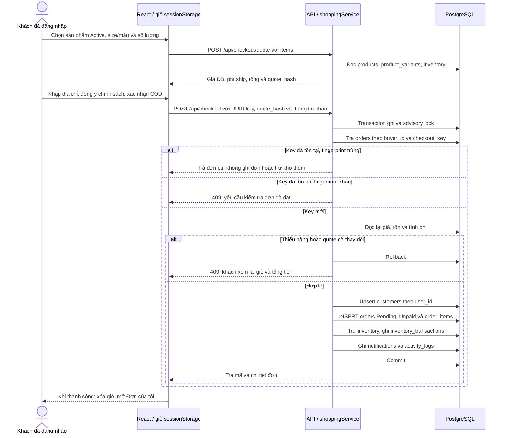
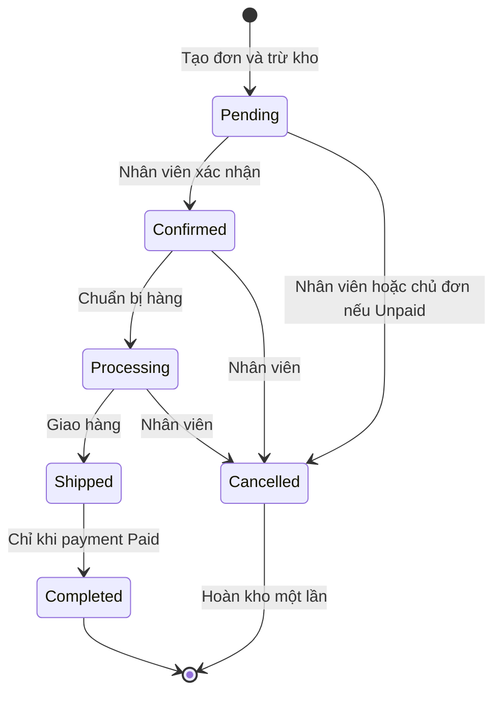
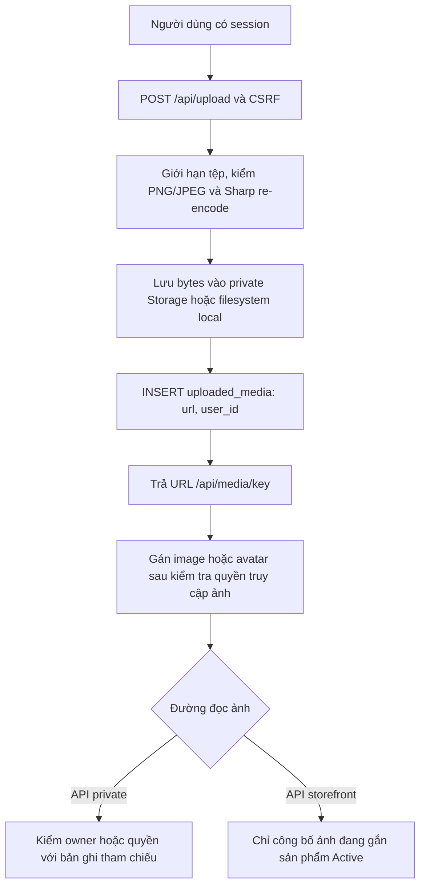
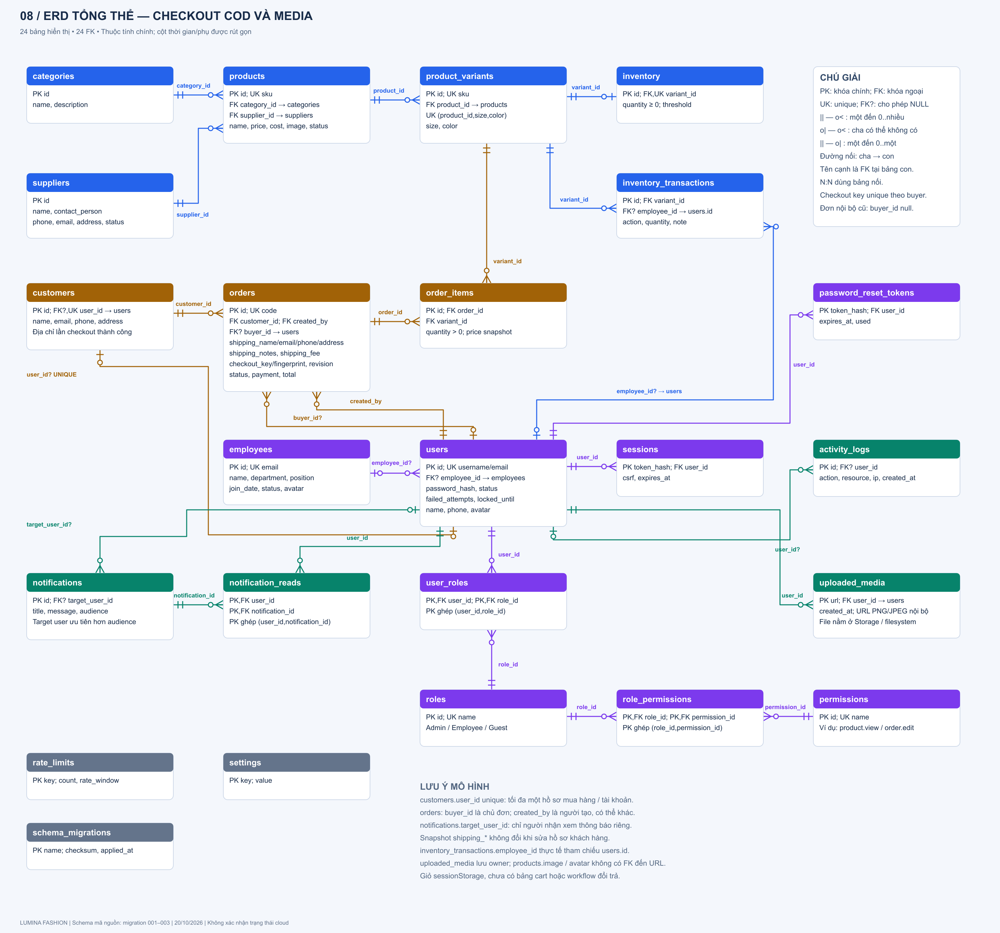

# LUMINA FASHION — Công nghệ, luồng hoạt động và ERD

Cập nhật **20/10/2026**, đối chiếu trực tiếp mã nguồn và các migration `001`–`003`. Tài liệu mô tả thiết kế hiện có trong repository; trạng thái triển khai Supabase/Vercel cần được kiểm chứng riêng. Không sử dụng giá trị bí mật trong `.env` để viết tài liệu.

## 1. Tổng quan website

LUMINA FASHION là website bán hàng và quản lý cửa hàng thời trang. Khách xem sản phẩm công khai, đăng nhập, chọn size/màu, đặt hàng COD và theo dõi đơn cá nhân. Nhân viên xử lý tồn kho và đơn hàng; quản trị viên quản lý thêm sản phẩm, danh mục, nhà cung cấp, nhân sự, tài khoản, phân quyền và báo cáo.

| Người dùng | Giao diện và hoạt động chính |
| --- | --- |
| Khách vãng lai, chưa đăng nhập | Xem trang chủ, catalog sản phẩm Active, chi tiết và chính sách; đăng nhập khi thêm giỏ hoặc mua |
| `Guest` đã đăng nhập, tài khoản Active | Storefront, giỏ hàng, báo giá, đặt COD, hồ sơ, đơn cá nhân và thông báo phù hợp |
| `Employee` | Workspace theo quyền: xem sản phẩm/khách hàng, xử lý kho, đơn hàng và thông báo |
| `Admin` | Quản trị hệ thống, duyệt đăng ký, cấp quyền, quản lý dữ liệu và xem báo cáo |

`Guest` là tên role khách mua trong mã nguồn. Khách chưa đăng nhập có `user = null`. Quyền mặc định khai báo trong `backend/src/services/demoSeedService.ts`, được dùng khi seed/khởi tạo qua `initializeService.ts`; API kiểm tra lại quyền hoặc chủ sở hữu ở mỗi thao tác. Các quyền quản trị nhạy cảm còn có giới hạn cố định trong `backend/src/middleware/security.ts`.

## 2. Công cụ, nền tảng và thư viện

Phiên bản trong bảng là khai báo của `package.json`, không phải kết quả dò phiên bản của dịch vụ đang chạy. `package-lock.json` khóa bộ dependency khi cài bằng `npm ci`.

| Lớp / nhóm | Công nghệ | Cách sử dụng trong website |
| --- | --- | --- |
| Ngôn ngữ | TypeScript `^5.9.3`, TSX, SQL, HTML, CSS | Viết giao diện, API, nghiệp vụ và cấu trúc/truy vấn dữ liệu |
| Giao diện | React / React DOM `19.3.0` | SPA, component, state, render storefront và workspace |
| Build / phát triển | Vite `^8.3.4`, plugin React `^6.0.2` | Dev server, proxy `/api` tới backend, build vào `frontend/dist` |
| Kiểu dáng / biểu tượng | CSS riêng, Lucide React `^1.55.0` | Responsive layout, màu sắc, component, icon |
| Biểu đồ | Recharts `^3.8.0` | Dashboard và biểu đồ báo cáo |
| Runtime / API | Node.js `24.x`, `node:http`, Web `Request`/`Response` | HTTP server local, routing/controller tự viết và API JSON |
| Chạy TypeScript | tsx `^4.20.6` | Chạy backend/script qua `node --import tsx` |
| Kiểm tra đầu vào | Zod `^4.6.6` | Validate kiểu, độ dài, enum, giới hạn số lượng, dữ liệu checkout |
| Cơ sở dữ liệu | PostgreSQL, driver `pg ^8.23.1` | SQL có tham số, connection pool, transaction, FK, UNIQUE, CHECK |
| Nền tảng dữ liệu | Supabase PostgreSQL | Database trên cloud; backend kết nối trực tiếp bằng `pg` |
| Lưu tệp | Supabase private Storage, SDK `^2.117.3` | Backend upload/download ảnh; local có filesystem dự phòng |
| Xử lý ảnh | Sharp `^0.35.5` | Kiểm tra, decode/re-encode PNG/JPEG, loại metadata dư |
| Email | Nodemailer `^10.1.0` | Gửi đường dẫn đặt lại mật khẩu khi đã cấu hình SMTP |
| Cấu hình | dotenv `^18.0.7`, Node `--env-file` | Đọc biến môi trường phía server |
| Xác thực | `node:crypto`, session cookie, PBKDF2, SHA-256 | Hash mật khẩu, tạo token phiên, hash token trước khi lưu DB |
| Phân quyền | RBAC và kiểm tra ownership trong backend | Role/permission cho workspace; `buyer_id` cho đơn cá nhân |
| Hosting | Vercel, `@vercel/functions ^3.9.11` | Frontend tĩnh và Node.js Function qua `api/index.ts` |
| Quản lý mã / CI | Git, GitHub Actions, Dependabot, npm | Quản lý phiên bản, build/test/audit và cập nhật dependency |
| Kiểm thử | Node assert, jsdom `^30.1.2`, PGlite `^0.5.8`, pglite-socket `^0.2.11` | Test UI với API giả lập và test backend trên PostgreSQL WASM tạm |
| Công cụ làm việc / tài liệu | VS Code, Browser DevTools, Mermaid, script Sharp | Biên tập, kiểm tra request/cookie, mô tả và xuất sơ đồ PNG |

React đảm nhiệm View; Node.js là runtime; Vite là công cụ phát triển/build; PostgreSQL là hệ quản trị cơ sở dữ liệu; Supabase và Vercel cung cấp dịch vụ triển khai. Backend tự viết routing, không sử dụng Express/NestJS/Next.js hoặc ORM. Xác thực do ứng dụng quản lý, không dùng Supabase Auth. Giỏ hàng dùng `sessionStorage` theo tài khoản/tab, không lưu trong PostgreSQL.

## 3. Kiến trúc và luồng request

Kiến trúc là SPA kết hợp API theo MVC có thêm lớp Service. View chạy trong trình duyệt, trao đổi JSON với backend.

| Thành phần | File / thư mục chính | Trách nhiệm |
| --- | --- | --- |
| View và điều hướng | `frontend/src/App.tsx`, `components/lumina/` | Bootstrap, phân nhánh storefront/workspace, điều hướng hash và hiển thị |
| API client / giỏ | `frontend/src/lib/client.ts`, `cart.ts` | Fetch, CSRF, giỏ riêng theo tài khoản |
| Adapter | `backend/src/server.ts`, `api/index.ts` | Nhận HTTP local hoặc request từ Vercel, đưa vào dispatch chung |
| Dispatch / routes / controller | `backend/src/app.ts`, `routes/apiRoutes.ts`, `controllers/apiController.ts` | Kiểm tra request, xác định endpoint, session/CSRF, gọi service và trả response |
| Service | `backend/src/services/` | Auth, catalog, kho, đơn, checkout, hồ sơ, ảnh và email |
| Model | `backend/src/models/` | Truy vấn SQL, connection pool, transaction, migration |
| Schema | `database/migrations/001_initial.sql` đến `003_media_ownership.sql` | Bảng, quan hệ, chỉ mục và ràng buộc |
| Triển khai / CI | `vercel.json`, `.github/workflows/ci.yml` | Build, rewrite `/api/*`, headers và kiểm thử |

Request ghi được bọc trong transaction và dùng advisory lock chung. `AsyncLocalStorage` giữ cùng DB connection trong request; `db().batch` dùng savepoint. Khi thao tác lỗi, dữ liệu nghiệp vụ rollback. Bộ đếm throttle được lưu ở transaction riêng; một số phản hồi đăng nhập thất bại vẫn commit để giữ số lần sai. File Storage và email là tác động ngoài PostgreSQL nên không được rollback cùng DB.

Local phát triển: Vite mặc định cổng `5173`, proxy API tới backend `3000`. Bản build có thể được Node phục vụ trực tiếp. Trên Vercel, `frontend/dist` là nội dung tĩnh, `/api/*` rewrite tới `api/index.ts`. Migration/seed là lệnh vận hành riêng, không tự chạy trong build hoặc mỗi request.

## 4. Luồng tài khoản và đăng nhập

Mật khẩu được hash bằng PBKDF2-HMAC-SHA256 với salt riêng. Cookie `lumina_session` chứa token ngẫu nhiên; bảng `sessions` lưu SHA-256 của token, `user_id`, CSRF và hạn dùng. Session thường có hạn DB 8 giờ; chọn ghi nhớ là 30 ngày. Request ghi có session gửi thêm `X-CSRF-Token`; backend kiểm tra session, origin và quyền.

Quên mật khẩu tạo token một lần trong `password_reset_tokens`, lưu hash và hạn 15 phút, gửi liên kết qua SMTP nếu được cấu hình. Reset thành công thu hồi session và token liên quan. Đổi email trong hồ sơ phải nhập đúng mật khẩu hiện tại; backend thu hồi token khôi phục và các session khác. Logout xóa session hiện tại và hết hạn cookie.

## 5. Luồng mua hàng COD và dữ liệu ERD

1. Storefront công khai gọi `/api/store/products` và chi tiết sản phẩm. Backend chỉ trả sản phẩm Active và các trường được công bố; không trả giá vốn/nhà cung cấp/số lượng kho nội bộ.
2. Khi đã đăng nhập, khách thêm biến thể vào giỏ; mỗi biến thể tối đa 99 sản phẩm. Giỏ chỉ là dữ liệu tạm trong trình duyệt, chưa giữ hàng.
3. Quote lấy giá và tồn từ DB. Phí mặc định 30.000đ, miễn phí từ 500.000đ tiền hàng; có thể đổi qua `SHIPPING_FEE` và `FREE_SHIPPING_THRESHOLD`. Quote chưa tạo đơn hoặc giữ kho.
4. Checkout lấy `buyer_id` từ session, kiểm lại quote và tồn; lưu COD dưới dạng `payment_method = 'Cash'`, `payment = 'Unpaid'`, `status = 'Pending'`.
5. `customers.user_id` xác định hồ sơ khách; `orders.customer_id` trỏ hồ sơ đó; `orders.buyer_id` xác định chủ đơn; `created_by` ghi người tạo. Checkout khách tự đặt có buyer và người tạo cùng tài khoản.
6. Đơn lưu snapshot `shipping_*`, phí ship và đơn giá `order_items.price`. Thay đổi địa chỉ hồ sơ hoặc giá sản phẩm về sau không tự thay snapshot đã lưu trên đơn.
7. Hệ thống **trừ kho ngay khi tạo đơn Pending**. Đơn, chi tiết, trừ kho, lịch sử kho, thông báo và audit được ghi cùng transaction.
8. UNIQUE `(buyer_id, checkout_key)` và fingerprint giúp retry cùng yêu cầu trả lại đơn cũ. Khi trả thành công, UI mới xóa giỏ. `/api/my-orders` lọc bằng `buyer_id` từ session.

Đơn nội bộ do nhân viên tạo qua `/api/orders` yêu cầu `order.create` và khách hàng có sẵn; server vẫn kiểm giá/tồn và trừ kho. Luồng này không có checkout key; `buyer_id` có thể NULL và đơn không tự xuất hiện trong Đơn của tôi chỉ vì email khách trùng tài khoản. Các lựa chọn Cash/Bank Transfer/Card ở workspace là thông tin ghi nhận thủ công.

## 6. Luồng xử lý đơn và kho

Nhân viên cần `order.edit` để cập nhật. Chỉ sửa sản phẩm trong đơn Pending/Confirmed: hoàn lượng cũ, thay chi tiết bằng giá hiện tại, trừ lượng mới và tính lại tổng nhưng giữ phí ship đã lưu. `revision` và điều kiện trạng thái ngăn ghi đè dữ liệu cũ. Đơn Shipped chỉ đi tiếp Completed; Completed/Cancelled không chỉnh sửa tiếp.

Khách tự hủy qua `POST /api/my-orders/:id/cancel`: kiểm `buyer_id`, Pending và Unpaid; hoàn tồn theo `order_items`, ghi lịch sử kho, đổi trạng thái, tăng revision, thông báo và audit trong transaction. Gửi lại yêu cầu với đơn đã Cancelled trả thành công mà không hoàn kho lần nữa. Nhân viên còn có thể hủy ở Confirmed/Processing theo quy tắc hệ thống.

| Thao tác kho | Dữ liệu thay đổi | Ý nghĩa |
| --- | --- | --- |
| Stock In | Tăng `inventory.quantity`; thêm `inventory_transactions` | Nhập hàng |
| Stock Out | Giảm tồn; thêm lịch sử âm | Xuất hàng, không cho âm kho |
| Adjustment | Đặt tồn thực tế; lịch sử lưu chênh lệch | Kiểm kê |
| Tạo đơn | Trừ theo từng variant; lịch sử gắn mã đơn trong `note` | Giữ hàng bằng cách giảm tồn khả dụng |
| Hủy đơn | Cộng lại tồn; ghi lịch sử hoàn | Không xóa đơn hoặc chi tiết lịch sử |

`inventory_transactions.employee_id` có FK tới **`users.id`**, nên cả thao tác checkout của Guest cũng ghi được người thực hiện. Bảng này không có `order_id`; việc liên hệ đơn qua `note` là liên hệ nghiệp vụ, không phải FK.

## 7. Luồng upload và đọc ảnh

`uploaded_media` ghi người tải ảnh; file thật nằm ngoài DB. `products.image`, `users.avatar`, `employees.avatar` là text URL, không có FK tới `uploaded_media.url`. Backend kiểm liên hệ này bằng truy vấn và quyền. Bucket giữ private; ảnh sản phẩm Active được đọc qua API công khai có điều kiện. Do Storage nằm ngoài transaction PostgreSQL, lỗi sau khi upload có thể để lại tệp cần dọn riêng.

## 8. ERD tổng thể và cách đọc

Sau khi áp dụng đủ migration trong mã nguồn có **23 bảng ứng dụng + `schema_migrations` = 24 bảng**, **24 FK**:

| Nguồn | Bổ sung |
| --- | --- |
| `001_initial.sql` | 22 bảng, 20 FK ban đầu |
| Migration runner `backend/src/models/migrate.ts` | `schema_migrations`, không có FK |
| `002_customer_checkout.sql` | Không tạo bảng; thêm 3 FK: customer–user, order–buyer, notification–target |
| `003_media_ownership.sql` | `uploaded_media` và 1 FK tới users |

Mã Mermaid độc lập, có thể mở trong trình xem Mermaid hoặc dùng để chỉnh sửa: [ERD.mmd](ERD.mmd). Các luồng và ERD cũng có trong [SO-DO.mmd](SO-DO.mmd), mỗi khối là một sơ đồ riêng. Ảnh PNG được tạo bằng `node docs/bao-ve/tools/render-diagrams.mjs`.

Ký hiệu: PK = khóa chính; FK = khóa ngoại; UK = duy nhất; `||` = đúng một; `o|` = không hoặc một; `o{` = không hoặc nhiều. Cardinality thể hiện ràng buộc DB. Ví dụ DB cho phép đơn chưa có dòng chi tiết, còn service tạo đơn yêu cầu ít nhất một dòng.

| Nhóm | Bảng | Vai trò trong luồng |
| --- | --- | --- |
| Catalog | categories, suppliers, products, product_variants | Phân loại, nguồn hàng, mẫu sản phẩm, biến thể size/màu |
| Kho | inventory, inventory_transactions | Tồn hiện tại và lịch sử nhập/xuất/điều chỉnh |
| Bán hàng | customers, orders, order_items | Hồ sơ khách, đơn và chi tiết có đơn giá snapshot |
| Nhân sự / tài khoản | employees, users | Hồ sơ nhân viên và tài khoản đăng nhập |
| RBAC | roles, permissions, user_roles, role_permissions | Vai trò, quyền và hai bảng nối N–N |
| Xác thực / giới hạn | sessions, password_reset_tokens, rate_limits | Session, token khôi phục và bộ đếm throttle |
| Thông báo / audit | notifications, notification_reads, activity_logs | Người nhận, trạng thái đã đọc theo user và nhật ký |
| Ảnh | uploaded_media | URL và chủ sở hữu upload |
| Cấu hình / migration | settings, schema_migrations | Key/value cấu hình seed và lịch sử migration/checksum |

### 8.1. Quan hệ và ràng buộc cần giải thích

| Quan hệ | Cardinality theo DB | Giải thích |
| --- | --- | --- |
| categories / suppliers → products | 1 → 0..N | Mỗi product bắt buộc có một category và một supplier |
| products → product_variants | 1 → 0..N | Mỗi variant thuộc một product; UNIQUE SKU và bộ `(product_id, size, color)` |
| product_variants → inventory | 1 → 0..1 | `inventory.variant_id` NOT NULL và UNIQUE; nghiệp vụ tạo variant kèm tồn |
| product_variants → inventory_transactions / order_items | 1 → 0..N | Lịch sử và dòng đơn cùng tham chiếu biến thể |
| customers → orders → order_items | 1 → 0..N ở mỗi bước | Đơn thuộc một customer; một dòng thuộc một đơn và một variant |
| users → customers | 0..1 ↔ 0..1 | `customers.user_id` nullable và UNIQUE; hồ sơ nội bộ có thể không có tài khoản |
| users → orders qua `buyer_id` | 0..1 → 0..N | Buyer có thể NULL với đơn nội bộ/cũ; dùng xác định ownership |
| users → orders qua `created_by` | 1 → 0..N | Mỗi đơn luôn có người tạo; không đồng nhất với người mua |
| employees → users | 0..1 → 0..N | `users.employee_id` nullable và không UNIQUE; schema chưa ép một nhân viên/một tài khoản |
| users ↔ roles ↔ permissions | N–N qua bảng nối | PK ghép của user_roles và role_permissions; UI hiện gán một role/user |
| users → sessions / password_reset_tokens / uploaded_media | 1 → 0..N | Phiên, token và ảnh luôn có tài khoản sở hữu |
| users → activity_logs / inventory_transactions | 0..1 → 0..N | Các FK người thực hiện cho phép NULL; lịch sử kho dùng tên cột employee_id |
| users → notifications | 0..1 → 0..N | `target_user_id` nullable; có target thì kiểm đúng người nhận, không phát cho toàn bộ audience |
| users ↔ notifications qua notification_reads | N–N | PK ghép `(user_id, notification_id)` giữ trạng thái đọc riêng |

Các bảng `rate_limits`, `settings`, `schema_migrations` không có FK. UNIQUE `(buyer_id, checkout_key)` áp dụng cho cặp giá trị checkout, không phải mỗi cột duy nhất toàn hệ thống. Username/email của users có thêm unique index trên `lower(...)`. CHECK bảo vệ tồn không âm, số lượng dòng đơn >0, total/phí ship không âm. Tiền dùng `numeric(14,2)` trong DB; tầng JavaScript hiện tính bằng Number.

Các FK cascade gồm product → variants, variant → inventory, order → items và user/notification → notification_reads. Các liên kết còn lại có thể chặn xóa bản ghi đang được tham chiếu; vô hiệu hóa/đổi trạng thái giúp giữ lịch sử. Không có FK từ `activity_logs.resource` hoặc ghi chú kho tới đơn hàng.

### 8.2. Từ thao tác người dùng đến các bảng

| Hoạt động | Bảng đọc chính | Bảng ghi chính |
| --- | --- | --- |
| Bootstrap / đăng nhập | users, user_roles, roles, role_permissions, permissions, sessions | sessions khi login, users cho lần đăng nhập/số lần sai, rate_limits, activity_logs |
| Đăng ký và Admin duyệt | users, roles và quyền của Admin | users, user_roles, notifications, activity_logs |
| Xem catalog / chi tiết | products, categories, product_variants, inventory | Không tạo đơn hoặc giữ kho |
| Thêm giỏ / sửa số lượng giỏ | Dữ liệu sản phẩm đã tải | sessionStorage phía trình duyệt |
| Quote | products, product_variants, inventory | Không ghi dữ liệu nghiệp vụ |
| Checkout mới | Giá/tồn, orders theo buyer/key, customers | customers, orders, order_items, inventory, inventory_transactions, notifications, activity_logs |
| Nhân viên cập nhật đơn | orders, order_items, inventory khi cần | orders; hủy/sửa items còn cập nhật kho và lịch sử; notifications cho buyer nếu có, activity_logs |
| Khách hủy đơn | orders theo buyer, order_items | orders, inventory, inventory_transactions, notifications, activity_logs |
| Đánh dấu thông báo đã đọc | notifications theo target/audience | notification_reads |
| Upload ảnh | Session và quyền | uploaded_media, activity_logs; bytes ở Storage/filesystem |
| Reset mật khẩu | users, password_reset_tokens | users, password_reset_tokens, sessions, rate_limits, activity_logs |
| Xem báo cáo | orders, order_items, products, customers, inventory | Không có bảng báo cáo riêng |

Các bảng session/quyền có thể được đọc thêm khi xác thực từng API; bảng trên tập trung dữ liệu của từng nghiệp vụ.

### 8.3. Ví dụ xuyên suốt để thuyết trình

Ví dụ giả định tài khoản `users.id = 12` chọn variant `id = 31` của một áo giá 200.000đ, số lượng 2, tồn hiện tại 5:

1. Giỏ lưu variant 31, số lượng 2 trong sessionStorage; DB vẫn còn tồn 5.
2. Quote trả tiền hàng 400.000đ, phí 30.000đ, tổng COD 430.000đ theo cấu hình mặc định.
3. Checkout tạo/cập nhật customer có `user_id = 12`; tạo order có `customer_id` vừa lấy, `buyer_id = created_by = 12`, Pending/Unpaid/Cash, snapshot người nhận và phí 30.000đ.
4. `order_items` ghi variant 31, quantity 2, price 200.000đ. Tồn giảm còn 3; `inventory_transactions` ghi lượng -2, `employee_id = 12`; phát thông báo và audit.
5. Retry cùng key/nội dung trả đơn đã tạo; tồn vẫn 3.
6. Khách hủy khi Pending/Unpaid: order thành Cancelled, tồn trở lại 5 và thêm lịch sử hoàn +2. Hủy lại không tăng tồn nữa.

Đây là số liệu minh họa để giải thích mô hình, không phải dữ liệu hoặc mã đơn của hệ thống đang triển khai.

## 9. Giới hạn chức năng và cách trình bày báo cáo

Checkout hiện hỗ trợ COD; chưa tích hợp cổng thanh toán, vận đơn hoặc workflow hoàn tiền/đổi trả tự động. Không có bảng giỏ server, thanh toán độc lập, vận chuyển độc lập hay bảng đổi trả trong schema hiện tại.

Doanh thu báo cáo lấy đơn Completed, kỳ báo cáo dựa trên `orders.created_at`. Lợi nhuận gộp dùng giá bán snapshot của dòng đơn trừ `products.cost` hiện tại, chưa có snapshot giá vốn. Tồn kho báo cáo là tồn hiện tại. Người dùng thiếu `report.view` chỉ nhận dashboard giới hạn, không nhận đầy đủ số liệu doanh thu/khách hàng/nhân sự.

Nguồn đối chiếu: [package.json](../../package.json), [migrations](../../database/migrations/), [controller](../../backend/src/controllers/apiController.ts), [shoppingService](../../backend/src/services/shoppingService.ts), [businessService](../../backend/src/services/businessService.ts), [mediaService](../../backend/src/services/mediaService.ts), [runtime](../../backend/src/config/runtime.ts) và [giỏ hàng](../../frontend/src/lib/cart.ts). Xem [báo cáo bảo vệ](BAO-CAO-BAO-VE.md) và [kết quả kiểm thử](VALIDATION.md) để biết thêm phạm vi kiểm chứng.
